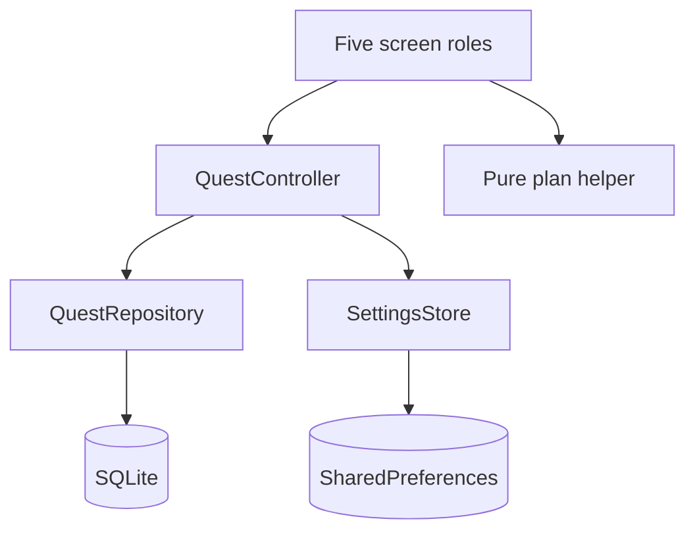

# Architecture and state ownership

## Boundaries

- models/workout.dart: typed plan/log data, bounds and JSON validation.
- data/quest_repository.dart: connection ownership, schema, parameterized reads/writes, transactions, unique draft/token constraints and persistence.
- data/settings_store.dart: preference validation and one serialized preference value.
- state/quest_controller.dart: shared records, loading/error/busy state and refresh after writes.
- screens/: local input controllers and interaction state. PlanEditor owns dirty form/saving state. WorkoutDetail owns an unsaved repetition entry and current correction index; persisted draft data remains in SQLite.
- services/plan_helper.dart: pure deterministic scoring and neutral baseline, with injected current time.
- widgets/common.dart: reusable stateless PlanCard, notices, confirmation and success feedback.

## State choice
ChangeNotifier plus AnimatedBuilder provides a small explicit shared state boundary for this undergraduate app. Local StatefulWidgets own forms and selected filters. Provider/Riverpod would reduce manual wiring as scope grows, but add a dependency for the current five roles. No graduate advanced-state claim is made.

## Write sequence
Validate input, disable repeated controls, perform the awaited repository operation, read current database records, and notify views. Failed writes retain UI input and show a retry message. If a post-write read fails, the controller shows a read error and Retry; the successful database write is not undone or falsely reinserted.

## Lifecycle
TextEditingControllers are disposed with their forms. Async paths check mounted before updating route state. The bootstrap owns the repository and controller. Repository.close awaits db.close; there is no cached global connection to reuse after closing. Controller stops notifications after disposal. No timers or subscriptions are needed. Abrupt OS process termination is handled by SQLite and does not require a final UI callback; draft writes happen after each set.

## Integrity
A partial unique index allows one draft per plan. Start queries and inserts in a transaction. saveSet checks expected saved-list length before appending. Finish validates all sets and transitions the existing row only once. Reset deletes draft rows only. Plan deletion cascades to logs. Session targets are snapshots and never follow later plan edits.

## Navigation and feedback
Catalog is the start route. Shell tabs keep filter state. Editor Save returns to its caller. Detail Back offers Keep, Discard or Stay for a draft. History editing uses a dialog belonging to S4. Plan expansion, saved-set progress, and completion feedback use 180/220/320 ms respectively; reduced motion uses zero duration. Finish feedback is transient and does not replay on relaunch.

## Test boundaries
Pure Dart fixture evaluation runs ranking without Flutter. FFI repository tests exercise Dart operations with real host SQLite. Widget tests check rendering and validation. Device integration test checks native SQLite close/reopen plus native preference access. A separate manual test is necessary for actual force-stop/relaunch and airplane mode. Host schema checks alone cannot establish any of these Flutter behaviors.

## Design implementation notes
Actual database identifiers use snake_case. The conceptual two-entity model is unchanged. Preferences are atomically represented by one JSON key, replacing the sketch's separate conceptual keys. Settings become visible after persistence succeeds, so a failure retains the last confirmed preference. This is documented in docs/design/design-changelog.md.

## Verification
The visible catalog, editor, saved-set card and history are consistent with the source structure above. The editor rejects -5 sets; the detail capture displays three saved sets with actual reps 3, 8 and 10. The deletion dialogs describe the intended parent cascade and completed-session removal. Screenshots cannot verify internal SQL or lifecycle behavior. Current source and APK binaries were not supplied for comparison.

Each installation owns its own SQLite database and settings. Separate device data is expected; no cloud sync is required or implemented in the available source.
